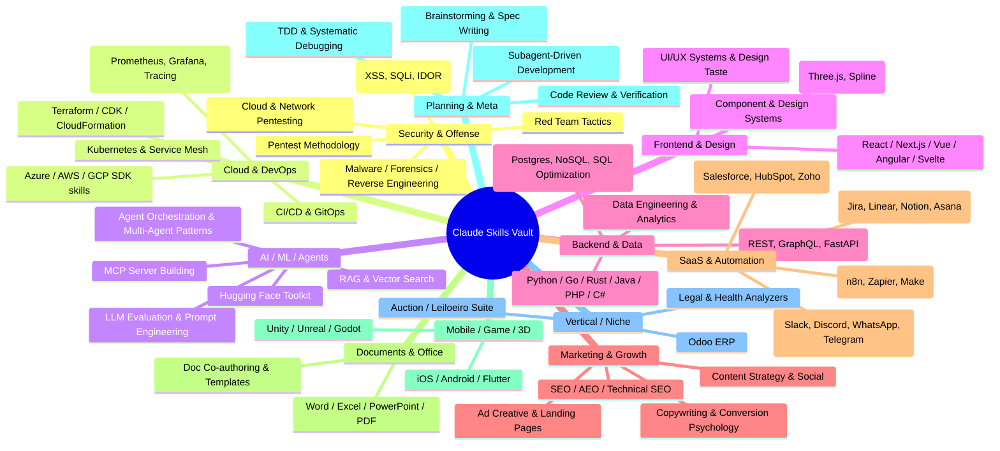
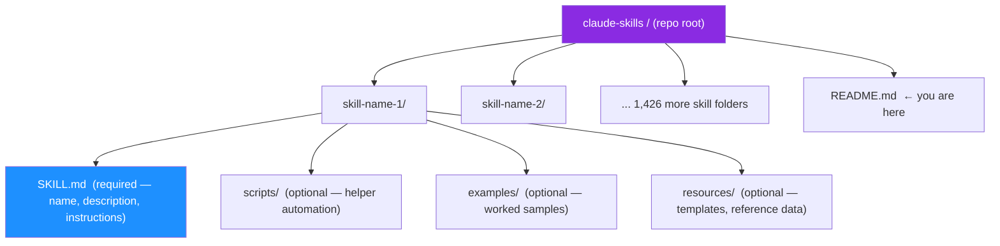
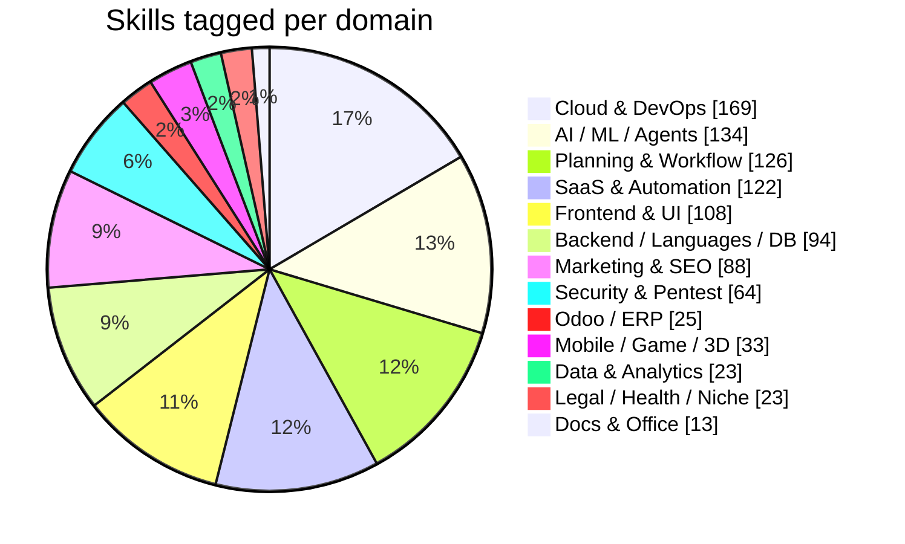
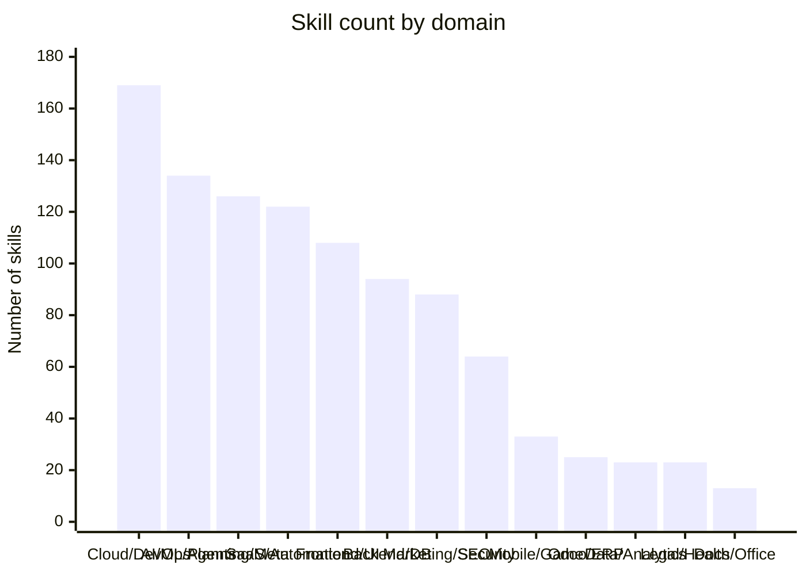
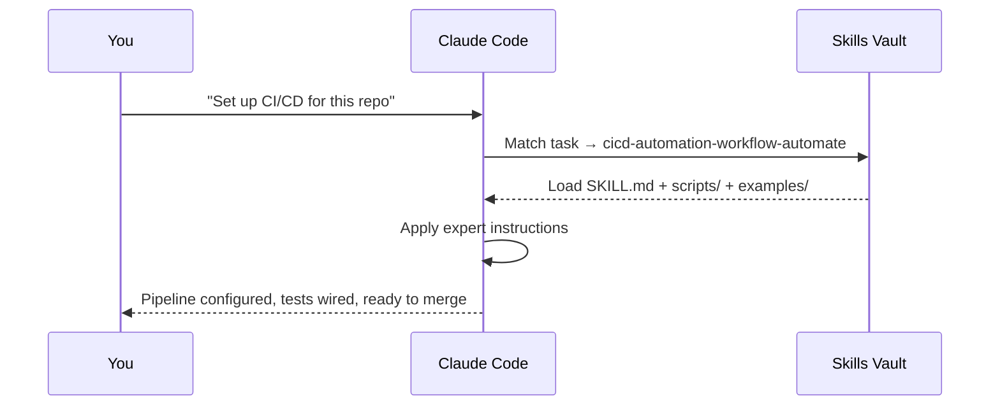

# 🧠 Claude Skills Vault

### The largest single-repo library of Claude / Claude Code skills — 1,428 expert modules, one `git clone` away.

<p align="center">
  
  
  
  
  
  
</p>

<p align="center">
  <b>One folder. One <code>SKILL.md</code>. One superpower.</b><br>
  Drop this repo into <code>.claude/skills/</code> and your agent instantly knows how to pentest an API, ship a Next.js app, run TDD, build a Kubernetes cluster, write SEO-proof copy, close a Stripe integration, or draft a legal brief.
</p>

---

## 📖 Table of Contents

- [What Is This?](#-what-is-this)
- [Why It's Different](#-why-its-different)
- [The Numbers](#-the-numbers)
- [Mind Map — How the Vault Is Organized](#-mind-map--how-the-vault-is-organized)
- [Repo Structure](#-repo-structure)
- [Category Breakdown (Pie)](#-category-breakdown)
- [Category Breakdown (Bar)](#-category-breakdown-bar-chart)
- [Skill Catalog + Real-World Use Cases](#-skill-catalog--real-world-use-cases)
- [How To Use a Skill](#-how-to-use-a-skill)
- [Anatomy of a Skill](#-anatomy-of-a-skill)
- [Quick-Start Playbooks](#-quick-start-playbooks)
- [Finding a Skill Fast](#-finding-a-skill-fast)
- [Contributing](#-contributing)
- [FAQ](#-faq)
- [Credits & References](#-credits--references)

---

## 🚀 What Is This?

**Skills** are self-contained instruction packets that teach an AI coding agent (Claude Code, or any `SKILL.md`-compatible agent) how to be an *expert* at one specific job — instead of a generalist guessing its way through. Each skill folder is a mini playbook: what it's for, when to reach for it, step-by-step instructions, and (often) helper scripts, templates and reference data.

This repo bundles **1,428 of them** into a single, ready-to-clone vault spanning security, cloud infra, AI/agent engineering, frontend, backend, data, SEO/marketing, SaaS automation, documents, mobile/game dev, ERP, and more.

> Think of it as hiring 1,428 specialists and keeping every one of them on call, for free, forever.

## 🔥 Why It's Different

| Typical prompt engineering | This skill vault |
|---|---|
| You re-explain context every session | Skill loads once, expertise persists |
| One generic "do everything" system prompt | 1,428 narrow, deep, single-purpose experts |
| Copy-paste snippets from old chats | Versioned, structured, reusable `SKILL.md` files |
| Ad-hoc, inconsistent output quality | Battle-tested instructions + scripts + examples per domain |
| Hard to share across a team | `git clone` and every teammate's agent gets the same superpowers |

## 📊 The Numbers

```
┌──────────────────────────────┬─────────┐
│ Total skills                 │  1,428  │
│ Total files                  │  4,354  │
│ Repo size                    │  ~93 MB │
│ Tagged categories             │    13   │
│ Skills with helper scripts    │  100s   │
│ Skills with reference data    │  100s   │
└──────────────────────────────┴─────────┘
```

---

## 🗺️ Mind Map — How the Vault Is Organized



---

## 🏗️ Repo Structure



**The only required file is `SKILL.md`.** Everything else — scripts, examples, resource bundles — is optional, added when a skill needs to *do* something rather than just *explain* something.

---

## 🥧 Category Breakdown

> Tags are non-exclusive — many skills legitimately span more than one domain (e.g. `azure-ai-agents-persistent-py` is both **Cloud** and **AI/Agents**), so category counts add up to more than 1,428.



## 📈 Category Breakdown (Bar Chart)



<details>
<summary>📉 Plain-text fallback bar chart (renders anywhere, even without Mermaid)</summary>

```
Cloud & DevOps            │████████████████████████████████████████████████████ 169
AI / ML / Agents          │██████████████████████████████████████████ 134
Planning & Workflow       │██████████████████████████████████████████ 126
SaaS & Automation         │████████████████████████████████████████ 122
Frontend & UI             │████████████████████████████████████ 108
Backend / Languages / DB  │███████████████████████████████ 94
Marketing & SEO           │██████████████████████████████ 88
Security & Pentest        │██████████████████████ 64
Mobile / Game / 3D        │████████████ 33
Odoo / ERP                │█████████ 25
Data & Analytics          │████████ 23
Legal / Health / Niche    │████████ 23
Docs & Office             │█████ 13
```

</details>

---

## 📚 Skill Catalog + Real-World Use Cases

Below is a curated tour of the vault — the highest-leverage skill from each domain, what it actually does, and a concrete scenario where it saves you hours.

### 🛡️ Security & Offense
| Skill | What it does | Use case |
|---|---|---|
| `pentest-checklist` | End-to-end methodology for authorized penetration tests | Kick off a client engagement with a rigorous, repeatable scope-to-report checklist |
| `burp-suite-testing` | Drives Burp Suite for web app security testing | Intercept and fuzz an API's auth flow during a bug-bounty engagement |
| `sql-injection-testing` | Structured SQLi discovery & validation (authorized targets) | Confirm and document a SQLi finding for a pentest report |
| `active-directory-attacks` | AD attack paths (Kerberoasting, lateral movement) | Simulate an internal breach in a red-team lab environment |
| `wireshark-analysis` | Packet capture triage and protocol analysis | Diagnose a suspicious spike in outbound traffic |
| `threat-modeling-expert` | STRIDE-style threat modeling for new systems | Threat-model a new payments microservice before it ships |

### ☁️ Cloud & DevOps
| Skill | What it does | Use case |
|---|---|---|
| `kubernetes-architect` | Designs and reviews K8s cluster architecture | Plan a multi-tenant cluster topology before migrating off VMs |
| `terraform-infrastructure` | Writes and reviews Terraform modules | Stand up a reproducible VPC + RDS + ECS stack from scratch |
| `cicd-automation-workflow-automate` | Builds CI/CD pipelines | Wire up test → build → deploy on every merge to `main` |
| `incident-responder` | Runs incident response playbooks | Coordinate the first 30 minutes of a production outage |
| `observability-engineer` | Sets up metrics, logs, and traces | Add distributed tracing to a service with no visibility today |
| `azure-ai-agents-persistent-py` | Builds persistent Azure AI Agent apps in Python | Ship a stateful support-agent backed by Azure AI Foundry |

### 🤖 AI / ML / Agent Engineering
| Skill | What it does | Use case |
|---|---|---|
| `mcp-builder` | Builds Model Context Protocol servers | Expose your internal API as tools an agent can call |
| `agent-orchestration-multi-agent-optimize` | Designs multi-agent orchestration patterns | Split a research task across specialist subagents safely |
| `rag-implementation` | End-to-end RAG pipeline design | Add "chat with our docs" to an internal knowledge base |
| `llm-evaluation` | Builds eval harnesses for LLM output quality | Catch a prompt regression before it ships to users |
| `prompt-engineering-patterns` | Reusable prompt design patterns | Tighten a flaky classification prompt into a reliable one |
| `context-window-management` | Strategies for long-context / memory management | Keep a long-running agent coherent across a multi-day task |

### 🎨 Frontend, UI & Design
| Skill | What it does | Use case |
|---|---|---|
| `frontend-design` | Production-grade frontend interface building | Turn a Figma-less idea into a polished, responsive UI |
| `react-best-practices` | Modern React patterns and pitfalls | Refactor a class-component legacy app to clean hooks |
| `ui-ux-pro-max` | Professional UI/UX: color, type, layout systems | Design a SaaS dashboard that doesn't look "AI-generated" |
| `web-artifacts-builder` | Builds React/Tailwind/Shadcn apps as artifacts | Prototype an internal tool in one sitting |
| `threejs-fundamentals` | Core Three.js 3D scene setup | Add an interactive 3D product viewer to a landing page |

### 🧩 Backend, Languages & Data
| Skill | What it does | Use case |
|---|---|---|
| `fastapi-pro` | Production FastAPI patterns | Stand up a typed, async Python API service fast |
| `postgresql-optimization` | Query and schema performance tuning | Fix a dashboard query that regressed from 200ms to 8s |
| `database-migrations-sql-migrations` | Safe migration authoring | Add a NOT NULL column to a 50M-row table without downtime |
| `graphql-architect` | GraphQL schema and resolver design | Design a federated schema across three services |
| `golang-pro` | Idiomatic, production Go patterns | Build a high-throughput ingestion worker |

### 📈 Marketing, SEO & Growth
| Skill | What it does | Use case |
|---|---|---|
| `seo-technical` | Technical SEO audits and fixes | Diagnose why a migrated site lost 40% of organic traffic |
| `seo-aeo-content-cluster` | Answer-engine-optimized content clustering | Build a topic cluster that ranks in both Google and AI answers |
| `copywriting-psychologist` | Persuasive copy grounded in behavioral psychology | Rewrite a pricing page that's converting below benchmark |
| `ad-creative` | Ad concept and creative generation | Generate 10 ad variants for a new product launch |
| `launch-strategy` | Go-to-market planning | Plan a coordinated product launch across channels |

### 🔗 SaaS, CRM & Automation
| Skill | What it does | Use case |
|---|---|---|
| `hubspot-automation` | HubSpot workflow & CRM automation | Auto-route inbound leads to the right rep by ICP fit |
| `n8n-workflow-patterns` | Reusable n8n automation patterns | Sync new Stripe customers into your CRM and Slack |
| `stripe-integration` | Stripe payments integration | Add subscription billing with proration handled correctly |
| `slack-bot-builder` | Builds Slack bots and apps | Ship an internal `/deploy` Slack command |
| `zapier-make-patterns` | No-code automation design patterns | Bridge two tools that don't have a native integration |

### 📄 Documents & Office
| Skill | What it does | Use case |
|---|---|---|
| `docx` | Create/edit/analyze Word documents | Generate a contract from a template and client data |
| `xlsx` | Excel spreadsheets with formulas & charts | Build a finance model with live formulas, not static numbers |
| `pptx` | Create/modify PowerPoint decks | Turn a written strategy doc into a board-ready deck |
| `pdf` | Extract, merge, split, fill PDF forms | Auto-fill 200 PDF intake forms from a spreadsheet |

### 📱 Mobile, Game & 3D
| Skill | What it does | Use case |
|---|---|---|
| `ios-developer` | Native iOS development patterns | Ship a SwiftUI screen that follows Apple HIG correctly |
| `flutter-expert` | Cross-platform Flutter development | Build one codebase targeting iOS + Android |
| `unity-developer` | Unity game development patterns | Implement a physics-based puzzle mechanic |
| `godot-gdscript-patterns` | Idiomatic Godot/GDScript | Structure a scene tree that won't fall apart at scale |

### 🧭 Planning, Workflow & Meta
| Skill | What it does | Use case |
|---|---|---|
| `brainstorming` | Structured design-before-code sessions | Explore 3 architectures before committing to one |
| `test-driven-development` | Red-green-refactor TDD workflow | Build a billing calculator with tests as the spec |
| `systematic-debugging` | Root-cause-first debugging method | Stop guess-and-check on an intermittent prod bug |
| `subagent-driven-development` | Coordinates multiple agents on one codebase | Parallelize a large refactor across independent modules |
| `skill-creator` | Creates new skills / updates existing ones | Package your team's tribal knowledge into a reusable skill |

### 🏢 Vertical & Niche
| Skill | What it does | Use case |
|---|---|---|
| `odoo-module-developer` | Custom Odoo module development | Add a bespoke approval workflow to Odoo Purchase |
| `legal-advisor` | Legal document analysis and drafting support | Get a first-pass read on a vendor contract's risk clauses |
| `startup-financial-modeling` | Startup financial model construction | Build a 3-statement model for a fundraising deck |

> **This table covers ~60 of the 1,428 skills.** Every skill in the repo follows the same `SKILL.md` contract, so browsing any folder gives you the full picture — see [Finding a Skill Fast](#-finding-a-skill-fast) below.

---

## ▶️ How To Use a Skill

```bash
# 1. Clone into your agent's skills directory
git clone https://github.com/jannatsheikhjks76732/claude-skills.git .claude/skills

# 2. Ask your agent to use one — either by name...
"Use the systematic-debugging skill to figure out why this test flakes."

# 3. ...or let it auto-select based on the task
"Refactor this class component to hooks."
# → agent recognizes this matches react-best-practices and loads it automatically
```



---

## 🧬 Anatomy of a Skill

```
skill-name/
├── SKILL.md         # required — frontmatter (name, description) + instructions
├── scripts/          # optional — automation the skill can execute
├── examples/         # optional — worked, copy-adaptable samples
└── resources/        # optional — templates, reference data, checklists
```

```markdown
---
name: my-skill-name
description: "One line — what this skill does and when to reach for it"
---

# Skill Title

## Overview
What this skill does, in plain terms.

## When to Use
- Trigger scenario 1
- Trigger scenario 2

## Instructions
Step-by-step expert guidance.

## Examples
Concrete before/after or worked samples.
```

---

## 🎯 Quick-Start Playbooks

**Shipping a feature end-to-end:**
`brainstorming` → `writing-plans` → `test-driven-development` → `code-reviewer` → `finishing-a-development-branch`

**Standing up new infrastructure:**
`terraform-infrastructure` → `kubernetes-architect` → `cicd-automation-workflow-automate` → `observability-engineer`

**Running an authorized security assessment:**
`pentest-checklist` → `burp-suite-testing` → `sql-injection-testing` → `postmortem-writing`

**Launching a product:**
`seo-technical` → `copywriting-psychologist` → `ad-creative` → `launch-strategy`

---

## 🔍 Finding a Skill Fast

```bash
# Browse everything
ls skills/

# Search by keyword
ls skills/ | grep -i "postgres"

# See what a skill actually does
cat skills/<skill-name>/SKILL.md
```

---

## 🌟 Contributing

1. Study an existing `SKILL.md` for the shape (frontmatter + Overview + When to Use + Instructions + Examples).
2. Add your skill folder following that structure.
3. Keep instructions specific and battle-tested — vague skills are worse than no skill.
4. Open a Pull Request.

---

## ❓ FAQ

**Do I need all 1,428 skills loaded at once?**
No — skills load on demand. Keeping the whole vault on disk costs nothing; your agent only pulls in what a given task needs.

**Can I use this outside Claude Code?**
Yes — `SKILL.md` is a plain, portable format. Any agent that understands "read this file, follow these instructions" can use it (`.claude/skills/`, `.agent/skills/`, `.gemini/skills/`, etc.).

**Is this an official Anthropic product?**
No — this is a community-assembled vault. A subset of skills originate from Anthropic's own public skill examples; the rest are community/domain contributions. Check individual `SKILL.md` files for provenance where noted.

**GitHub says a folder was "truncated to 1,000 files" — is content missing?**
No — that's GitHub's web file-browser UI limit on a single directory listing, not a limit on the repository. `git clone` pulls every file.

---

## 🙏 Credits & References

- [Anthropic Skills](https://github.com/anthropic/skills) — official Anthropic skill examples
- [Superpowers](https://github.com/obra/superpowers) — original superpowers collection
- [UI/UX Pro Max](https://github.com/nextlevelbuilder/ui-ux-pro-max-skill) — design skill pack
- [Planning with Files](https://github.com/OthmanAdi/planning-with-files) — file-based planning pattern
- [NotebookLM Skill](https://github.com/PleasePrompto/notebooklm-skill) — NotebookLM integration

---

<p align="center">
  <b>⭐ Star this repo if your agent just got a lot smarter.</b>
</p>
